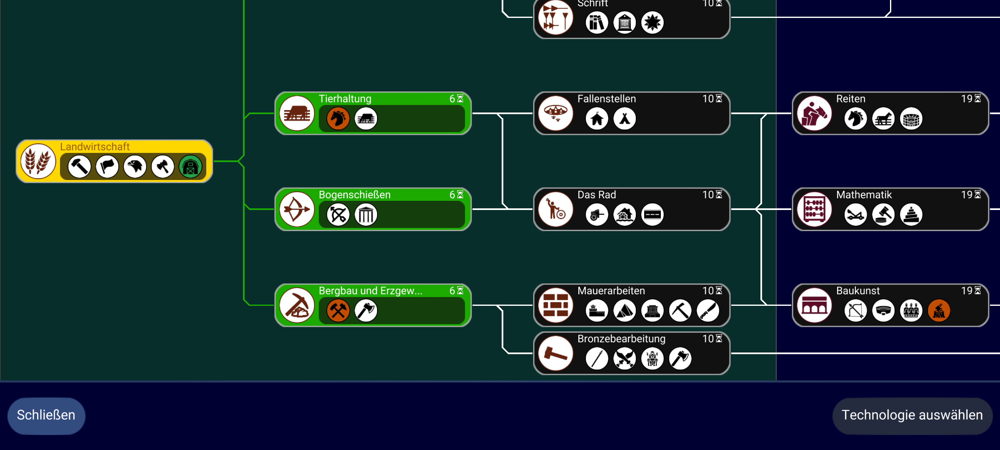
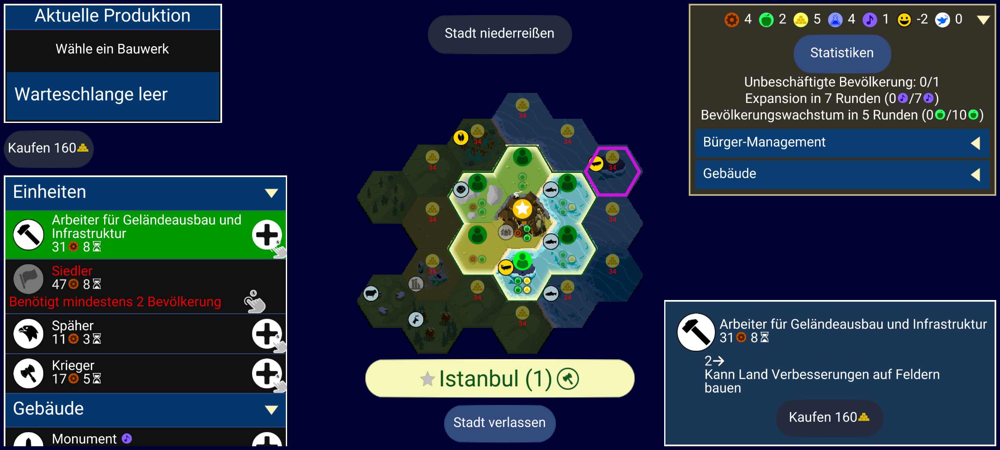

# Issue 8 Report

**Issue 8 remains incomplete: the build/capture work is complete; Anton's
labels and independent PR review are pending.** Clean 1271001 was captured in
German and English; defective 1271002 is installed and captured in German.
Anton chose
Mining and accepted the conditional ellipsis boundary as D-023. Anton created
`issue-8-pair` and separately authorized replacing probe with clean. The saved
Istanbul state and exact settings bytes survived both separately approved
APK replacements. F-Droid restoration has not been run and requires separate
approval for deletion and explicit data restoration.
No labels or evaluation inputs have been created. Both earlier probe images
remain exploration only.

- **What changed:** Added `docs/unciv-build.md` with the build/install/rollback
  plan, exact German probe strings, source-based width budgets and label-format
  proposal. A separate fork based on tag 4.22.10 / commit
  `899367522cea36d6063c84b02b41eedfa9a0d0e9` has a probe containing Mining and
  Worker changes plus versionCode 1271009. `BuildConfig.kt` changes build
  metadata (versionCode), not a translation or game logic. Final clean 1271001
  contains no translation change; final defective 1271002 contains only
  `Mining = Bergbau und Erzgewinnung`. Worker is restored to `Arbeiter` in both.
  Added the two observed probe outcomes to the issue 8 follow-up research notes
  in `docs/unciv-text-rendering.md`.
- **How it was verified:** Source inspection and standalone Android Paint
  measurements: Mining 169.54 / 140 units (+21.10%); Worker 356.94 / 273.33
  nominal units (+30.59%). Worker can grow its panel; this is not a hard title
  limit or an observed defect. JBR 21.0.10 arm64 and SDK package versions were
  inspected. SDK API 37.0 revision 2 and Build Tools 36.0.0 were installed. The
  probe APK built successfully (Gradle 2m 38s; wall 159.03s; exit 0; 45 executed
  tasks). APK metadata confirms com.unciv.app / 4.22.10 / 1271009, minSdk 21,
  targetSdk 36 and compileSdk 37. Both exact German values are packaged;
  AndroidLauncher occurs in DEX and the arm64 libgdx library is present.
  `apksigner verify --verbose --print-certs` exited 0 for the F-Droid and probe APKs and showed
  different signing certificates. The original installed APK, internal and
  external files and exact settings bytes are backed up locally. Settings
  checksum matches the device and the archived settings bytes match the
  standalone backup; adbd ended as shell. After Anton authorized the replacement,
  uninstall and probe installation each reported Success (exit 0). An independent
  package read confirmed 4.22.10 / 1271009 and DEBUGGABLE. `am start -W` reported
  Status: ok; the process and top resumed activity were independently confirmed.
  Boot, display size 1080 x 2400, density 420 and the existing fail-closed cutout
  check passed. Both probe screens were captured without restart or app-data
  writes after Anton opened each. Read-only `run-as` settings reads confirmed
  German, Small UI, font multiplier 1 and the default font family. PNG structure,
  CRC and 2400 x 1080 size passed; foreground and cutout passed before/after.
  Both final builds also succeeded (table below). Their packaged translation
  bytes match the expected clean/single-injection source, versionCodes and
  debug certificates match their records, and all seven DEX files plus all four
  native libgdx libraries are byte-identical between the two APKs. The only
  differing ZIP entries are German.properties, AndroidManifest.xml and signing
  metadata. Their other asset bytes are identical. Clean installation exited
  0 / Success; independent package metadata confirmed 4.22.10 / 1271001 and
  DEBUGGABLE. Read-only backups before and after installation contained identical
  settings and saved-game bytes. Adbd ended as shell, then `am start -W` exited
  0. Both final clean captures passed package/language/font/foreground/
  cutout checks before and after capture, settings stability and PNG CRC/size.
  Visual inspection shows the full `Bergbau` title with Archery selected.
  English shows the complete `Mining` title with Archery selected. The separately
  approved defective installation exited 0 / Success; independent metadata
  confirmed 4.22.10 / 1271002 and DEBUGGABLE. Current English settings and the
  named save matched their backups before the first defective launch, and
  adbd returned to shell. Anton manually restored German and loaded the same
  save. The final injected capture passed the same before/after checks; the
  Mining button ends in intentional ellipsis while the full name is absent
  elsewhere in the frame. Archery remains selected. F-Droid restoration and
  independent PR review are not run.
  At the preparation checkpoint,
  `uv run --offline pytest` exited 0: 181 passed, 1 skipped (the opt-in
  device test), 1 upstream google-genai/Python deprecation warning in 28.09s.
  Ruff check and format check exited 0 (30 files already formatted), and
  `git diff --check` passed. `--run-device` was not run: capture/device code is
  unchanged. A fresh offline run after the decision/research/build/install
  documentation updates exited 0: 181 passed, 1 skipped (opt-in device test),
  1 upstream deprecation warning in 21.45s. Ruff check and format check exited
  0 (30 files already formatted). Output is retained separately from the
  original preparation checks. Later documentation changes record these results
  and capture metadata; no checker code changed.
- **Deviations from the task:** Anton explicitly approved a preliminary
  two-injection probe before the one-injection pair. Probe images are exploration
  only in this Report and are excluded from labels and evaluation. Manual
  navigation plus SDK `adb exec-out screencap -p` replaces the existing capture
  CLI for these screens, because the CLI relaunches into the main menu. No
  navigation/debug hook or repository dependency is added. Initial clone
  attempts failed in the network sandbox; authorized retries succeeded. The
  first SDK request used the unavailable `android-37` package identifier; the
  corrected `android-37.0` request succeeded. Initial Gradle bootstrap timed out
  after 67.62 seconds at the wrapper's 10-second read timeout. Predownloading
  the same pinned distribution and verifying its official SHA-256 recovered
  the unchanged wrapper; no build-configuration patch was made. A fresh-clone
  Git refresh initially reported four asset read timeouts; subsequent clean
  status/diff checks succeeded, and no asset changes are in the probe commit.
  The first offline uv sync could not access the shared cache in the sandbox;
  the authorized offline retry installed only the existing locked dependencies.
  The first standalone font helper failed because app_process had not initialized
  the Android font map (exit 137, NullPointerException); initializing that map
  fixed the helper, with both subsequent measurements exiting 0.
  Before pairing, `run-as` could list internal files but external-file discovery
  returned Permission denied in stdout despite adb exit 0. The read was treated
  as failed. A read-only backup with temporary adb root succeeded; settings
  bytes were stable across it, and adbd returned to shell. The stored turn-1
  Autosave did not contain Istanbul, so Anton was asked to create a new
  `issue-8-pair` save before any APK replacement. Anton created it; inspection
  confirmed Ottoman Istanbul on turn 1. No save was fabricated or written by
  the agent.
- **Decisions:** **D-023 is Accepted by Anton**: ellipsis is `truncated_text`
  only if the full text is not visible anywhere else in the same screenshot.
  If the full text is shown elsewhere, the shortened label is not a defect.
  The former Proposed workflow/label-format entry was moved from D-023 to
  **D-024 (Proposed)**, reserving D-023 for Anton's explicit accepted decision.
  Existing Accepted entries were not rewritten.
- **Open questions for Anton:** Review the three final PNGs and write the human
  label files using the proposed format in `docs/unciv-build.md`. Final human
  labels and clean-control acceptance remain Anton-owned; no placeholder label
  files or agent-written empty arrays exist. Independent PR review is required
  before merge; the author does not approve this PR. Every subsequent app
  replacement/deletion or explicit data overwrite still needs its own approval.
- **API usage:** No live provider calls; no detector output or hold-out access.
  No new dependencies in this repository. Existing Android/Gradle build inputs
  are downloaded as required by the unchanged upstream configuration.

## Exploration only: probe 1271009

| Screen | Actual behavior |
|---|---|
| Technology picker / Mining | **Observed:** the title ends in `...`, omitting the end of `Erzgewinnung`, inside the fixed-width TechButton. This is the source's intentional-ellipsis path. The full injected name is not visible elsewhere in this screenshot; no target-title collision is visible. Anton subsequently accepted the conditional D-023 boundary. The probe is still not a label. |
| City construction / Worker | **Observed:** the complete title fits on one line in the lower-right construction panel, without ellipsis, edge loss or visible collision. In the available-constructions list it wraps onto two lines, retaining the full text. The panel accommodates the title beyond the nominal budget; this is consistent with source-driven growth, but its width change versus a clean build has not been measured. `truncated_text` is not demonstrated. |

The Technology capture is 393,632 bytes, 2400 x 1080; SHA-256
`68f2f287f19b312bff501793bb563da03a81b7768d935b0e0027ea479f4bc49b`.
No clean-control comparison has been made yet. These observations are
exploration, not ground-truth labels.



The Worker capture is 562,946 bytes, 2400 x 1080; SHA-256
`56f2a11958c5cb3a12c5cc7d7b1b6edf726b04e94de3a655fc2b3624f5fc0e71`.



**Accepted human decision, not a probe label:** Anton chose A. Under D-023,
ellipsis counts as `truncated_text` only when the full text is not visible
elsewhere on the same screenshot. B showed successful adaptation and is not
presented as truncation. No text loss without a marker was observed in these
two probes; this is a finding about the inspected cases, not proof of absence
throughout Unciv. The [research follow-up](../../unciv-text-rendering.md#issue-8-follow-up-observed-german-rendering-probe)
records both observations.

**Expected limitation, not a measured result:** The OCR + translation-table
baseline is expected to catch this case easily; v1 may show no model advantage
on this class. Text loss without a marker is deferred to Stage 8 (second app).

## Final pair: built, installed and captured

| Build | Fork commit | VersionCode | Gradle / wall time |
|---|---|---:|---|
| Clean, original translations | `2e4d6af664e204c4ddcc06383a0e2e700a9665c4` | 1271001 | 1m 29s / 89.84s |
| Defective, Mining only | `038329f93966a8d1d0ac7f23f551c98feb32614c` | 1271002 | 1m 26s / 86.78s |

Both share upstream base `899367522cea36d6063c84b02b41eedfa9a0d0e9`,
versionName 4.22.10 and the probe's verified debug signing certificate. Each
build executed 42 tasks with 3 up-to-date in the warm task-local cache. The
builds exited 0. `BuildConfig.kt` changes versionCode build metadata only.

- Clean APK: 32,475,086 bytes; SHA-256
  `47b98d930c8699625e8df6dee3fce49ae0d600cab2356382279e006ce791f644`.
- Defective APK: 32,475,095 bytes; SHA-256
  `cac0bb72d87fa91e2de7a132827f3acd2c23716e2f0aba41d287db74e023c7b4`.

Source guards confirm that clean differs from the pinned base in BuildConfig.kt
only, and defective differs in that metadata file plus exactly one Mining value
in German.properties. [pair-manifest.json](pair-manifest.json), the source
diffs and [pair-apk-comparison.json](pair-apk-comparison.json) record the checks.

Anton separately authorized the probe-to-clean downgrade (translated from
Russian): "Yes, replace probe with clean." Executed command:

```bash
adb -s emulator-5554 install -r -d outputs/issue-8/Unciv-clean-1271001.apk
```

The installer reported `Performing Streamed Install` / `Success`, exit 0.
Independent `dumpsys package` confirmed versionCode 1271001. No uninstall or
explicit settings/save overwrite was performed. Before the first clean launch,
read-only backup comparisons verified unchanged settings and `issue-8-pair`:

- Saved game: 118,426 bytes, Ottoman Istanbul on turn 1; SHA-256
  `9d2a4cd5e1de2b2ae9102a2e6e6d15210e32ae5188c895f84e8a3a6ce19c3b4e`.
- Current settings: 645 bytes; SHA-256
  `dc35061fcf8011635bfb2d0f94999c5de7bf8b4fafea64ace9803264f8117b10`.

Private backups are retained under `data/issue-8/backups/probe-saved-pair/`
and `data/issue-8/backups/clean-after-install/`. Adbd was returned to shell.
The clean launch exited 0. Anton manually loaded/navigated to the German screen;
both clean-language captures are complete.

Anton then explicitly authorized (translated from Russian): "Yes, replace
clean with defective." Executed command:

```bash
adb -s emulator-5554 install -r outputs/issue-8/Unciv-defective-1271002.apk
```

The installer reported `Performing Streamed Install` / `Success`, exit 0.
Independent `dumpsys package` confirmed versionCode 1271002. Before the first
defective launch, read-only backups verified the unchanged named-save checksum
and the then-current English settings checksum recorded below. No uninstall
or explicit settings/save overwrite was performed. Adbd returned to shell;
`am start -W` exited 0. Anton switched back to German in the UI and loaded the
same named save for the defective capture.

## Final screen captures (unlabeled)

| Capture | Installed build | State | SHA-256 |
|---|---:|---|---|
| German clean | 1271001 | Captured; Archery selected, `Bergbau` fully visible | `a6a5beb3ef17ce4a640261821ff1bfc02f2dfda0e81c1cfb3aadaa32407f954e` |
| English clean control | 1271001 | Captured; Archery selected, `Mining` fully visible | `88ff1c55aef33cc9ff0fd89cd5912384b7a1017d8d9ca2d88965ec39389b9f47` |
| German injected | 1271002 | Captured; Archery selected, Mining title has intentional ellipsis | `372aa318ce3bf4d553b4b9d427a7fe6d87f566953605c21bc705dd10df816b93` |

The [German clean PNG](final/tech-picker__de__2400x1080__clean__1271001.png)
is 459,752 bytes, 2400 x 1080. Package version, persisted German, Small UI,
default font/scale, foreground and disabled cutout were checked before/after;
settings bytes remained stable. No restart or app-data overwrite occurred
during capture. The whole frame was retained. Anton loaded the frozen save
manually; loading and selected screen identity are not automatically verified
by `screencap`. Target inspection is an observed finding, not a human label or
an assertion that every other visible element is defect-free.

The [English clean PNG](final/tech-picker__en__2400x1080__clean__1271001.png)
is 460,083 bytes, 2400 x 1080 and passed the same checks with persisted English.
Anton switched language in the UI; the agent did not overwrite settings.
Manual navigation gives approximate scroll alignment, not pixel-identical
framing. Both captures show the same technology-tree neighborhood with Archery
selected and the complete Mining name. After both captures, another read-only
backup confirmed the named save's unchanged SHA-256 and retained the current
English settings (662 bytes; SHA-256
`e0b6586f1893ac84f6249809ab349a4d6fc4a2fdea7fe79b53142bf7c1436808`).
The save omits `baseRuleset` and `mods`; their effective pinned-source defaults
are Civ V - Gods & Kings and no mods, respectively. This is a source-derived
interpretation of omitted fields, not an explicit value stored in the save.

The [German injected PNG](final/tech-picker__de__2400x1080__injected__1271002.png)
is 480,275 bytes, 2400 x 1080 and passed the same checks with persisted German
and versionCode 1271002. The Mining title ends in intentional ellipsis after
`Erzgew`; the full `Bergbau und Erzgewinnung` is not visible anywhere else in the
frame. Archery/Bogenschießen is selected and its description is displayed.
This observed condition meets Anton's D-023 boundary, while final ground truth
remains his responsibility. The tree neighborhood is the same as clean; manual
navigation leaves a minor vertical-scroll difference in the description area.
No pixel-identical framing is claimed. The whole PNG is retained without
cropping, resizing or overlays. Current German settings were stable during
capture (682 bytes; SHA-256
`1f3c27fd5599b9c7a1051efd24e565a3257d50558dcd0feb4696af41368e0f63`).

Defective 1271002 remains installed for Anton's review. Returning to F-Droid
requires a new deletion approval and an explicit data-restoration approval;
original APK/settings/game-file backups remain private on the Mac.

## Command evidence

Every device command is retained with stdout/stderr and exit status. Binary
stdout and private backups are saved to named local files with size and SHA-256
rather than printed. Public transcripts also include saved non-private text
readbacks and normalize the SDK executable to `adb`.
Current raw working evidence is local under `data/issue-8/`; selected command
evidence is retained beside this Report. Private app backups are excluded.

## Verified artifacts and gate

- Fork probe commit: `190275d1e4490dceb682cf881f8c3433c1b53162`.
- Probe APK: 32,475,142 bytes; SHA-256
  `31a798f9d446eb396ba7465001778c519754e62b43f750e609de7cee2c778e1f`.
- Backed-up original F-Droid APK: 27,531,553 bytes; SHA-256
  `caddedb60a6dcaf0199950251e027cefe363b7d2388cbc4c5d4587edaa1de9f2`.
- Original settings: 93 bytes; SHA-256
  `3b55ab3dd62845e1c31374bb604446d0a3b672045ba030e90810d9354fabaa6d`.
- Original private and external file archives are readable and retained in the
  private local backup. Their checksums and the probe APK checksum were rechecked
  immediately before replacement. F-Droid was uninstalled and probe installed
  after Anton explicitly answered (translated from Russian): "Yes, uninstall
  F-Droid and install the probe."
  No agent settings/save overwrite or restoration has been run.

Authorized and executed commands (both exit 0 / Success):

```bash
adb -s emulator-5554 uninstall com.unciv.app
adb -s emulator-5554 install outputs/issue-8/Unciv-probe-1271009.apk
```

Anton selected German, founded Istanbul, opened the Technology picker and
then selected Worker in the city screen. Both exploratory captures are complete.
Existing settings were not imported into the fresh debug installation.
Every later app replacement or explicit data overwrite still has its own
confirmation gate. Read-only preflight excerpts are in
[device-preflight.txt](device-preflight.txt); full command records and saved-output
checksums are in [device-commands.txt](device-commands.txt).

## Changed files at this build/install checkpoint

- Checker: `docs/unciv-build.md`, `docs/unciv-text-rendering.md`, `docs/decisions.md`, this Report, and the
  supporting text/JSON evidence listed in [README.txt](README.txt).
- Fork: `android/assets/jsons/translations/German.properties` and
  `buildSrc/src/main/kotlin/BuildConfig.kt` only; probe commit
  `190275d1e4490dceb682cf881f8c3433c1b53162`, clean commit
  `2e4d6af664e204c4ddcc06383a0e2e700a9665c4` and defective commit
  `038329f93966a8d1d0ac7f23f551c98feb32614c`.
- No checker runtime, test, dependency or lockfile changes. No labels, metrics
  or matching changes. APKs, settings and saves remain outside tracked files.
